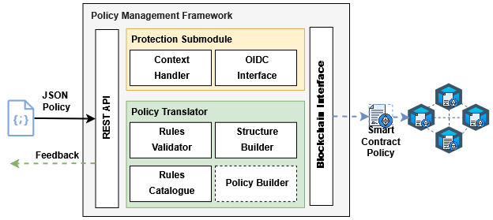

# CIPHER Just in Time Access Control Interface


This project extends the ExtremeXP Access Control module for use in the CIPHER project,
providing an interface for translating XACML policies into Solidity smart contracts for EVM-compatible
blockchains or Go chaincode for Hyperledger Fabric.
The module's key features include:

- Decentralized access control layer.
- Blockchain abstraction layer.
- Translating XACML policies into Solidity smart contracts or Go chaincode.  
- Deploying the generated policies onto the target blockchain.
- Manages the lifecycle of the policies and their associated smart contracts.
- Provides a RESTful API for managing policies and their associated smart contracts.
- Provides a Swagger UI for interacting with the API.

> Note: The translator project is based on the [XACML](https://www.oasis-open.org/committees/xacml/) standard 
and supports policy generation in [Solidity](https://soliditylang.org/) for EVM-compatible blockchains and Go for
Hyperledger Fabric.

---
## Architecture

#### The Access Control Interface Architecture (v1.0.0)


---

#### Project Architecture (v1.0.0)


---

## Getting Started
```bash
# install the project development environment
make install
# run the project
make run
```
The server will be running on http://localhost:5521.
The Swagger documentation is available on the root page.

---

## Setup

### Hyperledger Fabric Setup

This project uses the **Hyperledger Fabric Sample Test Network** to deploy and execute the ABAC smart contracts (chaincode).

#### 1. Prerequisites

Before proceeding, ensure the following dependencies are installed:

- **Docker Engine / Docker Desktop** and Docker Compose v2
- **Go** (compatible with the chaincode's `go.mod`)
- **Git**
- **cURL**
- **Make**
- **Bash**

Ensure Docker is running before starting the network.

#### 2. Install Hyperledger Fabric

From the project root, execute:

```bash
cd fabric
./install-fabric.sh
```

This script automatically downloads and configures `fabric-samples`, including the required Fabric binaries and Docker images.

#### 3. Configure the Environment

Navigate to the Fabric test network:

```bash
cd fabric-samples/test-network
```

Load the environment variables and configure Organisation 1:

```bash
export PATH=${PWD}/../bin:$PATH
export FABRIC_CFG_PATH=${PWD}/../config/
source scripts/envVar.sh
setGlobals 1
```

#### 4. Start the Network

From the `test-network` directory, run:

```bash
./network.sh up createChannel
```

This starts the Fabric network and creates the default channel (`mychannel`).

#### 5. Build the ABAC Chaincode

**Recommended:** Open a second terminal to build the chaincode without leaving the test-network directory.

From the project root:

```bash
cd fabric/chaincode/abac
make build
```

#### 6. Deploy the ABAC Chaincode

Return to the first terminal, inside fabric-samples/test-network.

For the initial deployment, execute:

```bash
./network.sh deployCC \
  -ccn abac \
  -ccp ../../chaincode/abac \
  -ccl go \
  -ccv 1.0 \
  -ccs 1
```
This deploys the ABAC chaincode to the default channel (mychannel).

For subsequent upgrades, increment the lifecycle sequence and, optionally, the chaincode version. For example:
```bash
./network.sh deployCC \
  -ccn abac \
  -ccp ../../chaincode/abac \
  -ccl go \
  -ccv 1.1 \
  -ccs 2
```

> **Note:** The lifecycle sequence must increase when updating an existing chaincode definition. The chaincode version is an application-defined label and does not necessarily need to change.

#### 7. Next Steps

With the network running and the ABAC chaincode deployed, the next step is to execute integration tests to verify connectivity, chaincode execution and transaction processing.

---

[//]: # (## Development Progress -> v1.1.0)

[//]: # (#### Overall progress: )

[//]: # (![]&#40;https://geps.dev/progress/66&#41;)

[//]: # ()
[//]: # (#### Tasks:)

[//]: # (- [x] CIPHER SSI integration)

[//]: # (- [ ] CIPHER Northbound interface integration.)

[//]: # (- [x] Support for Hyperledger Fabric chaincode.)

[//]: # (- [x] Support for multiple blockchain networks.)

[//]: # (- [x] Support for multiple policy types.)

[//]: # (- [ ] Support for CIPHER feedback messages &#40;alert triggers&#41;)

## Usage
For full documentation of the API endpoints, please refer to the pages available at 
How-to: https://yagorezende.github.io/extremexp_accesscontrol
Swagger UI: https://yagorezende.github.io/extremexp_accesscontrol/swagger
