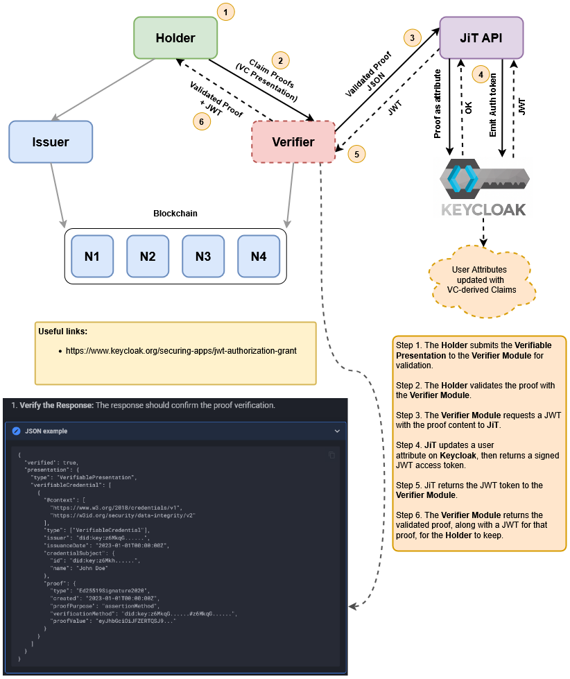

# CIPHER Just in Time Access Control Interface
### JiT integration with CIPHER SSI module
> This document describes the initial integration approach between the CIPHER Self-Sovereign Identity (SSI) module and the Just-in-Time (JiT) Authorisation module. The objective of this early implementation is to demonstrate how validated Verifiable Credential (VC) presentations can be transformed into standard OIDC/JWT authentication tokens using Keycloak, enabling seamless integration with the existing JiT access control mechanism.
>
> The proposed approach preserves the SSI trust model by requiring credential verification before authentication while allowing protected services to continue relying on standard JWT bearer tokens. This provides a practical interoperability layer between decentralized identities and the ExtremeXP-based JiT authorization infrastructure without requiring changes to the policy enforcement components.
>
> The implementation described in this document represents an initial proof of concept focused on validating the integration architecture. More advanced features, such as full OpenID4VP support, credential lifecycle management, and continuous revalidation, will be addressed in subsequent iterations.

---
## Authentication Flow (v1.0.0)
The following sequence describes how a validated Verifiable Credential (VC) presentation is transformed into a standard OIDC/JWT authentication token that can be consumed by the JiT authorization infrastructure.

### Architecture (v1.0.0)

### Step 1 – Holder submits a Verifiable Presentation

The Holder creates a Verifiable Presentation (VP) according to the requested authentication scenario and submits it to the Verifier. The presentation contains one or more Verifiable Credentials (VCs) and is cryptographically signed by the Holder to prove possession of the credentials.

Output

Signed Verifiable Presentation
Holder proof of possession
### Step 2 – Verifier validates the presentation

The Verifier validates the received Verifiable Presentation by checking:

* Credential issuer signatures
* Holder proof of possession
* Credential integrity
* Expiration
* Revocation status (when applicable)
* Presentation validity

If all checks succeed, the Verifier extracts the attributes required for authorization and produces a validated proof.

Output

Validated VC proof
Verified identity attributes

### Step 3 – Verifier requests an authentication token from JiT

The Verifier sends the validated proof to the JiT API, requesting an authentication token for the authenticated Holder.

This step establishes the interoperability bridge between the SSI verification process and the existing OIDC-based authorization infrastructure.

Input

Validated VC proof
### Step 4 – JiT requests a JWT from Keycloak

The JiT API communicates with Keycloak, updating the authenticated user's attributes with VC-derived claims before requesting an OIDC/JWT access token.

Keycloak is preconfigured with protocol mappers that include these attributes as JWT claims, allowing downstream services to consume them using standard OIDC mechanisms.

Output

Signed JWT access token
VC-derived authorization claims
### Step 5 – JiT returns the JWT to the Verifier

After successful authentication, the JiT API returns the signed JWT access token to the Verifier.

The token now represents the authenticated identity and can be used by existing authorization components without requiring native SSI support.

### Step 6 – Verifier returns the authentication result to the Holder

Finally, the Verifier returns both the validated proof and the generated JWT access token to the Holder.

The Holder can now authenticate to protected services using a standard Bearer token, while the embedded VC-derived claims provide the authorization context required by the JiT access control mechanism.